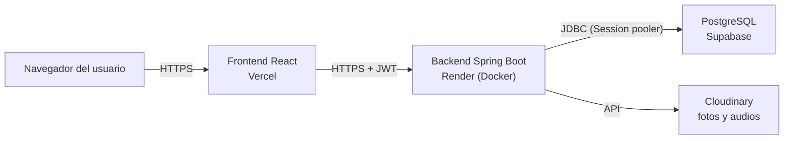

# TicketDesk: Guía de Despliegue en la Nube

## Documento base: Trabajo Final Integrador UTN TUPaD

Este documento describe cómo se despliega TicketDesk en servicios online gratuitos, qué decisiones se tomaron y qué limitaciones hay que conocer. Las condiciones de los planes gratuitos se verificaron el 9 de octubre de 2026 y pueden cambiar.

---

## 1. Arquitectura de despliegue



| Componente | Servicio | Plan |
|---|---|---|
| Frontend (React + TypeScript) | Vercel | Hobby (gratuito) |
| Backend (Spring Boot) | Render, como servicio web con Docker | Free |
| Base de datos (PostgreSQL) | Supabase | Free |
| Fotos y audios | Cloudinary | Free |

El requisito de la cátedra pide al menos un componente online. En este proyecto están desplegados los cuatro.

## 2. Por qué estos servicios

- **Vercel** para el frontend: despliega directo desde GitHub, entrega HTTPS (necesario para que el navegador permita usar el micrófono en la creación de tickets por voz) y detecta proyectos Vite automáticamente.
- **Render** para el backend: permite desplegar desde GitHub un servicio web gratuito. No ejecuta Java de forma nativa, por eso el backend incluye un `Dockerfile`.
- **Supabase** para la base de datos: ofrece PostgreSQL real. Se descartó la base gratuita de Render porque vence a los 30 días de creada, lo que dejaría el proyecto sin datos antes de la defensa.
- **Cloudinary**: ya se usaba durante el desarrollo, solo cambia dónde se cargan las credenciales.

## 3. Limitaciones del plan gratuito y cómo se manejan

| Limitación | Efecto | Qué hacer |
|---|---|---|
| El servicio de Render se duerme tras 15 minutos sin tráfico | La primera consulta después de una pausa tarda cerca de un minuto en responder | Abrir la aplicación unos minutos antes de una demostración o defensa |
| Render ofrece 750 horas gratuitas por mes y por workspace | Alcanzan para tener un servicio encendido todo el mes | Mantener un único servicio gratuito |
| Los proyectos gratuitos de Supabase se pausan tras una semana sin actividad | La base queda inactiva hasta restaurarla a mano desde el panel | Entrar a la aplicación al menos una vez por semana, o restaurar el proyecto desde el panel de Supabase |
| La base de Supabase gratuita tiene 500 MB | Sobra para el volumen de este proyecto | Sin acción |
| Render solo admite conexiones IPv4 | La conexión directa de Supabase usa IPv6 y falla desde Render | Usar la cadena del **Session pooler** (puerto 5432), que es compatible con IPv4 |
| El pooler en modo transacción (puerto 6543) no sirve para Hibernate | Falla por el uso de sentencias preparadas | Usar siempre el puerto 5432 |

Las tareas programadas del backend (cierre automático a las 72 horas y rebote por estancamiento) se ejecutan cada hora mientras el servicio está activo. Si el servicio estuvo dormido, se ponen al día en la primera ejecución posterior, porque las reglas se calculan por fecha.

## 4. Variables de entorno del backend

Se cargan en el panel de Render (sección Environment). Ningún valor secreto está en el repositorio: `application.properties` solo contiene marcadores.

| Variable | Valor | Descripción |
|---|---|---|
| `SPRING_DATASOURCE_URL` | `jdbc:postgresql://HOST_DEL_POOLER:5432/postgres?sslmode=require` | Cadena JDBC del Session pooler de Supabase, sin usuario ni contraseña |
| `SPRING_DATASOURCE_USERNAME` | `postgres.REFERENCIA_DEL_PROYECTO` | Usuario del pooler (incluye la referencia del proyecto) |
| `SPRING_DATASOURCE_PASSWORD` | la contraseña de la base | La definida al crear el proyecto en Supabase |
| `CLOUDINARY_CLOUD_NAME` | nombre de la nube | Panel de Cloudinary |
| `CLOUDINARY_API_KEY` | clave de la API | Panel de Cloudinary |
| `CLOUDINARY_API_SECRET` | secreto de la API | Panel de Cloudinary |
| `JWT_SECRET` | cadena aleatoria de 64 caracteres o más | Firma de los tokens. Distinta a la de desarrollo |
| `APP_CORS_ALLOWED_ORIGINS` | `https://URL-DEL-FRONTEND.vercel.app` | Orígenes autorizados a llamar a la API. Varios se separan con coma |
| `APP_SEED_ENABLED` | `true` o `false` | Con `true` se cargan los datos de prueba si la base está vacía |
| `APP_SEED_PASSWORD` | contraseña de los usuarios de prueba | Opcional. Por defecto `Demo1234!` |
| `SPRING_JPA_SHOW_SQL` | `false` | Evita llenar los registros con consultas SQL |

Render define por su cuenta la variable `PORT`, y `application.properties` la usa con `server.port=${PORT:8080}`.

Para generar un valor de `JWT_SECRET` en PowerShell:

```
-join ((48..57) + (65..90) + (97..122) | Get-Random -Count 64 | ForEach-Object { [char]$_ })
```

## 5. Variable de entorno del frontend

| Variable | Valor |
|---|---|
| `VITE_API_URL` | `https://URL-DEL-BACKEND.onrender.com/api/v1` |

Vite incorpora esta variable al compilar. Si se cambia en Vercel hay que volver a desplegar para que tenga efecto.

El archivo `frontend/vercel.json` redirige todas las rutas a `index.html`, para que las direcciones internas de la aplicación (por ejemplo `/tickets/123`) funcionen al recargar la página.

## 6. Procedimiento de despliegue

### 6.1 Base de datos (Supabase)

1. Crear una cuenta en supabase.com y un proyecto nuevo llamado `ticketdesk`.
2. Definir una contraseña para la base, sin caracteres especiales, y guardarla.
3. Elegir la región más cercana a la del backend (por ejemplo East US, North Virginia).
4. Con el proyecto creado, abrir el botón **Connect**, elegir **Session pooler** y la pestaña **JDBC**. De ahí se obtienen el host del pooler y el usuario (`postgres.REFERENCIA`).

### 6.2 Backend (Render)

1. Crear una cuenta en render.com e iniciar sesión con GitHub.
2. **New**, **Web Service**, y elegir el repositorio `ticketdesk-tpi`.
3. Completar: Name `ticketdesk-backend`, Region cercana a la base (Virginia u Ohio), Root Directory `backend`, Runtime `Docker`, Instance Type `Free`.
4. En **Advanced**, cargar las variables de la sección 4 (por ahora `APP_CORS_ALLOWED_ORIGINS` con un valor provisorio) y definir Health Check Path `/api/v1/auth/empresas`.
5. Crear el servicio. La primera compilación tarda varios minutos.
6. Cuando esté en estado **Live**, abrir `https://URL-DEL-BACKEND.onrender.com/api/v1/auth/empresas`. Debe mostrar la lista de empresas en JSON.

### 6.3 Frontend (Vercel)

1. Crear una cuenta en vercel.com e iniciar sesión con GitHub.
2. **Add New**, **Project**, e importar el repositorio `ticketdesk-tpi`.
3. Completar: Root Directory `frontend`, Framework Preset `Vite`. En **Environment Variables** cargar `VITE_API_URL`.
4. **Deploy**. Al terminar, Vercel muestra la dirección pública.

### 6.4 Conectar el frontend con el backend

1. En Render, editar `APP_CORS_ALLOWED_ORIGINS` con la dirección real de Vercel (sin barra final) y guardar. El servicio se reinicia solo.
2. Abrir la dirección de Vercel, elegir la empresa e iniciar sesión.

## 7. Verificación posterior al despliegue

- [ ] La lista de empresas carga en la pantalla de login
- [ ] Inicio de sesión como cliente, agente, supervisor y administrador
- [ ] Creación de un ticket por formulario
- [ ] Creación de un ticket por voz (la grabación y la transcripción funcionan en Chrome o Edge)
- [ ] Subida de una foto a un ticket
- [ ] Recorrido completo: tomar, resolver, cerrar
- [ ] Escalado con motivo obligatorio
- [ ] Panel de administración: módulos, categorías y usuarios
- [ ] Recargar una pantalla interna del frontend no devuelve error 404
- [ ] Las horas que muestra la aplicación coinciden con la hora de Argentina

## 8. Seguridad

- Las credenciales de base de datos, Cloudinary y JWT existen únicamente como variables de entorno en Render. El repositorio es público y solo contiene marcadores.
- El frontend y el backend se comunican por HTTPS.
- El backend acepta peticiones solo desde los orígenes definidos en `APP_CORS_ALLOWED_ORIGINS`.
- El secreto de JWT de producción es distinto al de desarrollo.
- Los datos de prueba (`APP_SEED_ENABLED=true`) existen para poder evaluar el sistema. En un uso real se desactivan y se crean las empresas y usuarios reales.

## 9. Problemas frecuentes

| Síntoma | Causa probable | Solución |
|---|---|---|
| El backend no arranca y el registro dice `Unable to determine Dialect without JDBC metadata` | No logra conectarse a la base | Revisar la URL, el usuario y la contraseña de las variables `SPRING_DATASOURCE_*` |
| Error de red o de conexión hacia una dirección IPv6 | Se usó la conexión directa de Supabase | Usar el host del Session pooler |
| Errores de sentencia preparada inexistente | Se usó el puerto 6543 | Usar el puerto 5432 |
| En el navegador aparece un error de CORS | El origen no está autorizado | Corregir `APP_CORS_ALLOWED_ORIGINS` con la dirección exacta de Vercel |
| El frontend dice que no puede conectarse al servidor | `VITE_API_URL` faltante o incorrecta | Debe empezar con `https://` y terminar en `/api/v1`. Luego volver a desplegar |
| Recargar una pantalla interna da 404 | Falta `vercel.json` | Agregarlo en la carpeta `frontend` |
| La primera consulta tarda mucho | El servicio de Render estaba dormido | Esperar alrededor de un minuto |
| Todo falla de golpe tras una semana sin uso | Supabase pausó el proyecto | Restaurarlo desde el panel de Supabase |

## 10. Registro del despliegue

Esta tabla se completa al desplegar.

| Dato | Valor |
|---|---|
| Fecha del despliegue | |
| URL del frontend | |
| URL del backend | |
| Proyecto de Supabase | |
| Observaciones | |
