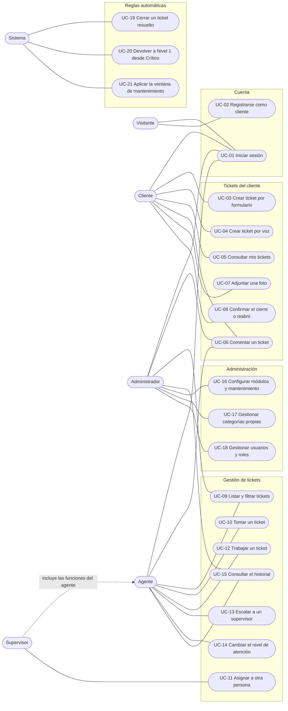
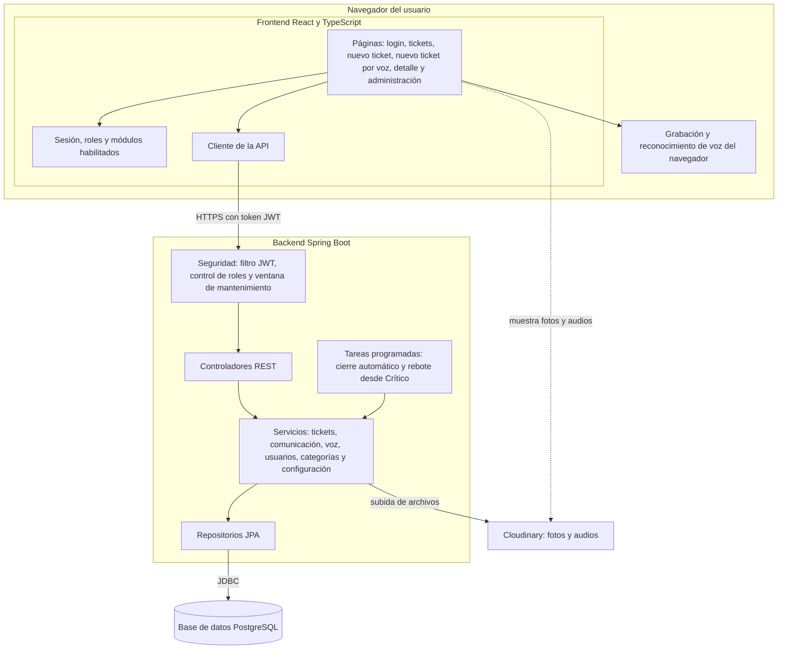
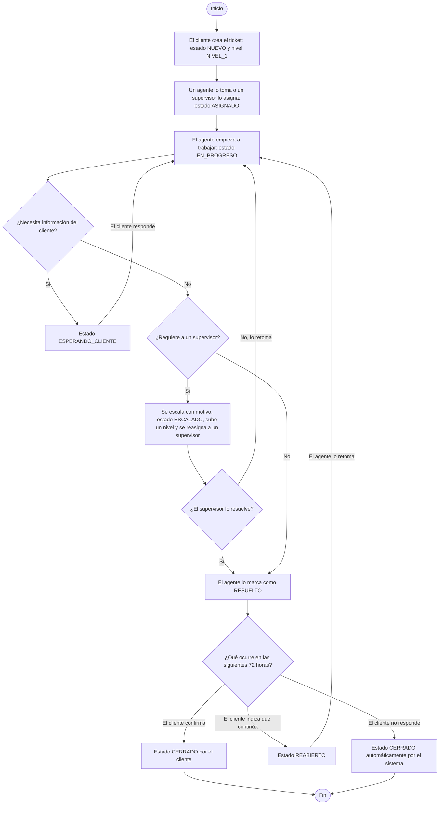
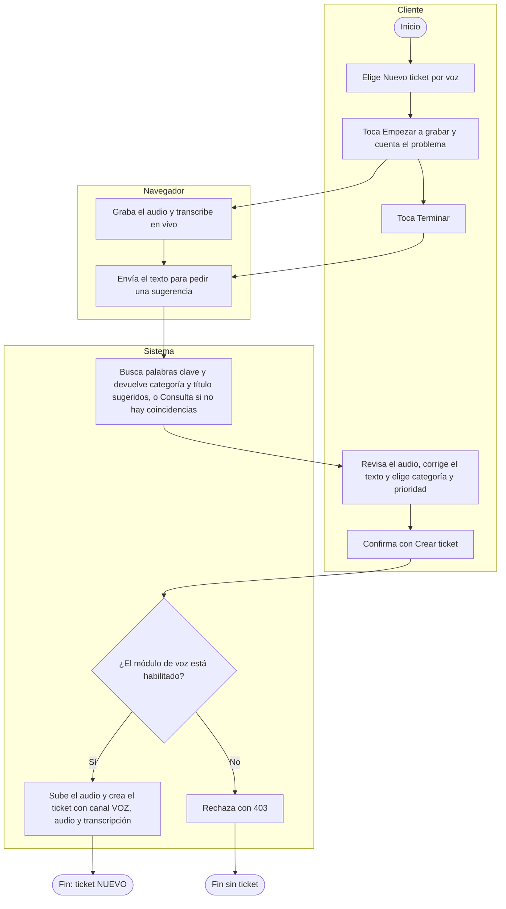
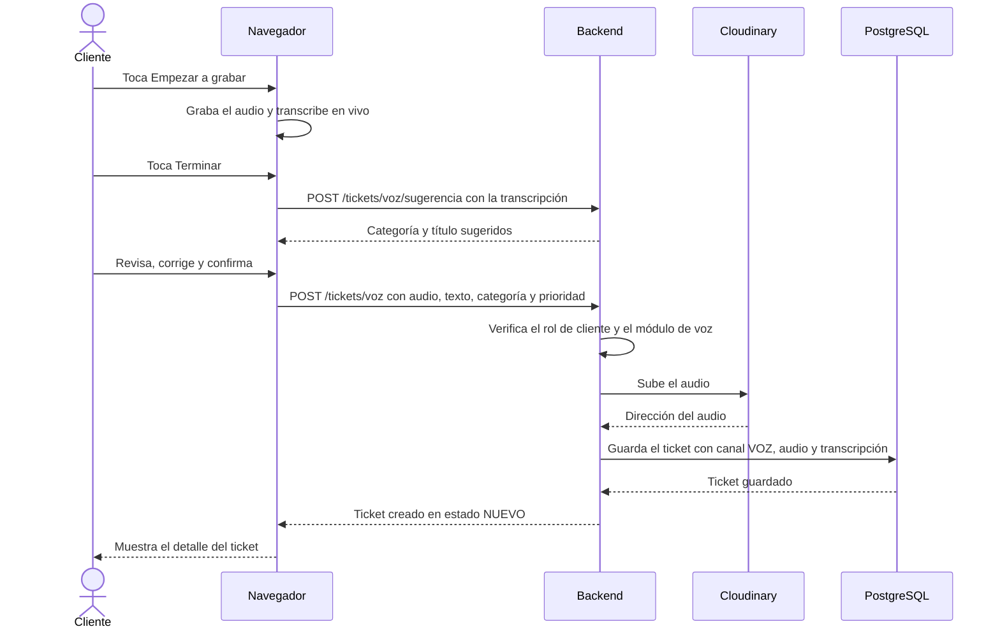
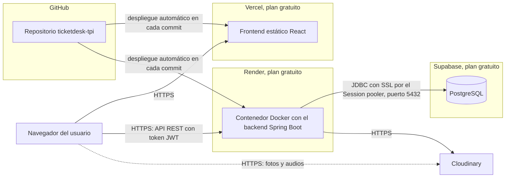
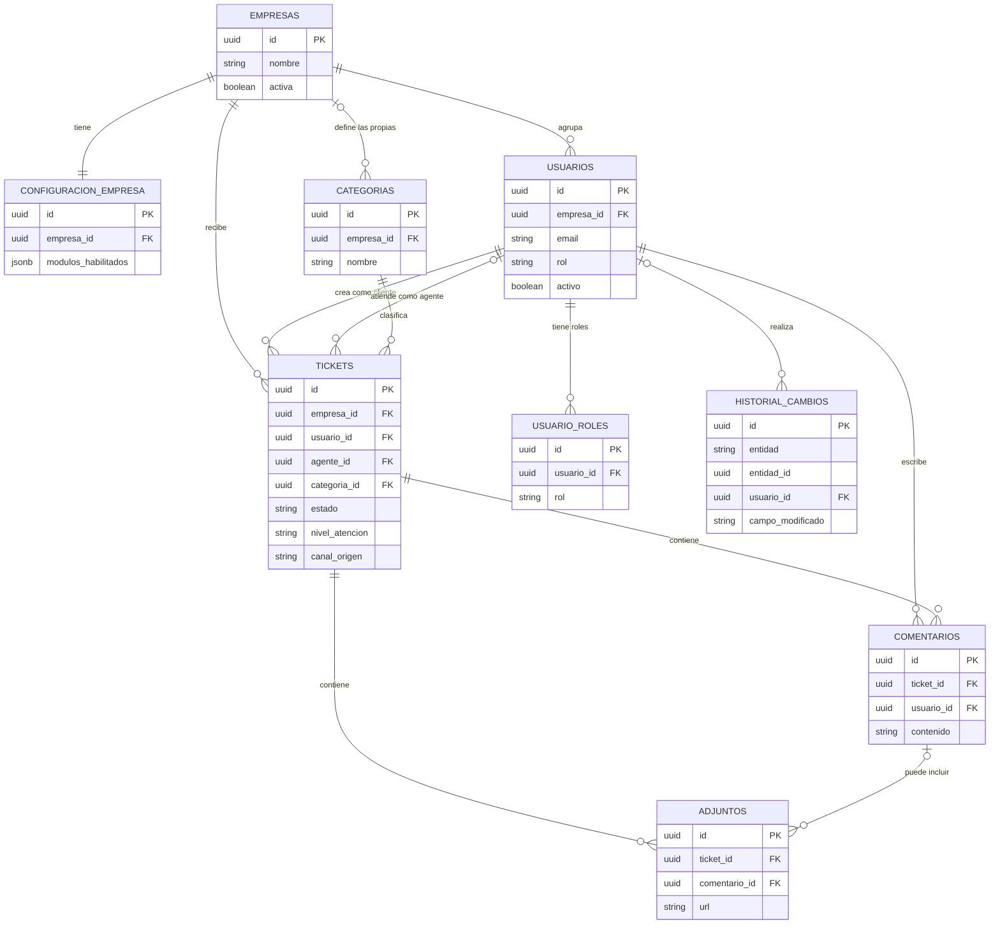

# TicketDesk: Diagramas UML

## Documento base: Trabajo Final Integrador UTN TUPaD

Este documento reúne los diagramas que complementan la documentación del sistema: casos de uso, componentes, actividades, secuencia, despliegue y entidad-relación. Están escritos en un formato de texto que GitHub dibuja automáticamente, de modo que se mantienen junto al código y se pueden editar sin herramientas externas.

Los nombres de actores, estados y entidades siguen el `diccionario-nomenclatura-ticketdesk.md`. Los casos de uso se detallan en `casos-de-uso-ticketdesk.md`.

---

## 1. Diagrama de casos de uso

Muestra qué actor realiza cada caso de uso. El supervisor incluye todo lo que hace un agente. Los casos automáticos los ejecuta el sistema. El formato de texto no tiene una figura propia para los casos de uso, por lo que se representan con óvalos agrupados por área.

## 2. Diagrama de componentes

Muestra las partes que forman el sistema y cómo se comunican. El backend sigue una arquitectura por capas: la seguridad filtra cada petición, los controladores la reciben, los servicios aplican las reglas de negocio y los repositorios acceden a los datos.

## 3. Diagramas de actividades

### 3.1 Ciclo de vida de un ticket

### 3.2 Creación de un ticket por voz

## 4. Diagrama de secuencia: creación de un ticket por voz

## 5. Diagrama de despliegue

Muestra dónde se ejecuta cada parte del sistema en el entorno en línea.

Particularidades del plan gratuito, descritas en `despliegue-ticketdesk.md`: el backend se suspende tras 15 minutos sin visitas y la base de datos se pausa tras una semana sin actividad.

## 6. Diagrama entidad-relación

Resume las nueve tablas del modelo de datos con sus claves. El detalle de todos los campos está en `DER-ticketdesk.md` y en `schema.sql`. El campo `entidad_id` del historial apunta a distintas tablas según el valor de `entidad`, por eso no tiene una clave foránea.

