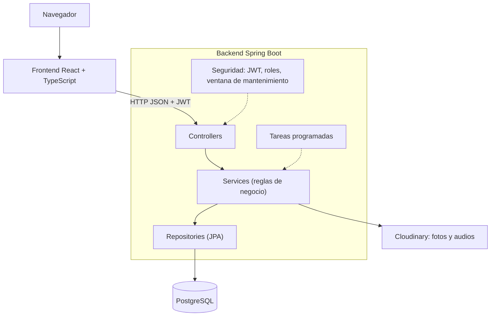

# TicketDesk: Informe Final

## Trabajo Final Integrador, UTN TUPaD

**Autor:** Santiago Raúl Salinas
**Tutor:** Gerardo Adrian Herrera
**Repositorio:** https://github.com/AralarGG/ticketdesk-tpi
**Aplicación en línea:** https://ticketdesk-tpi.vercel.app

---

## 1. Resumen

TicketDesk es un sistema web multi-empresa para gestionar tickets de soporte. Centraliza en un único lugar todo el ciclo de vida de un reclamo o consulta: desde que el cliente lo crea (por formulario o hablando) hasta que se resuelve y se cierra, con estados claros, permisos por rol y un historial completo de cada cambio.

El sistema está formado por una API REST en Spring Boot, una aplicación web en React con TypeScript y una base de datos PostgreSQL, y se despliega en la nube mediante Vercel, Render y Supabase. Su funcionalidad diferencial es la **creación de tickets por voz**, con transcripción en el navegador, sugerencia automática de categoría y confirmación del usuario antes de crear el ticket.

## 2. Problema

Las empresas que atienden reclamos y consultas de clientes (productos de software, videojuegos, plataformas online, comercios, servicios) suelen manejarlos con planillas sueltas, chats internos o correos sin trazabilidad. Esto produce:

- Solicitudes que se pierden porque no quedan registradas en un único lugar.
- Esfuerzo duplicado cuando dos agentes atienden el mismo reclamo sin saberlo.
- Falta de visibilidad sobre qué tickets están pendientes, quién los atiende y hace cuánto.
- Imposibilidad de priorizar correctamente entre consultas urgentes y de baja relevancia.
- Ausencia de historial, que dificulta entender el contexto si cambia el agente asignado.

## 3. Objetivos

**Objetivo general:** desarrollar un sistema que centralice la carga, el seguimiento y la resolución de tickets de soporte, con trazabilidad completa.

**Objetivos específicos:**

- Centralizar la carga y el seguimiento de tickets en una sola plataforma.
- Permitir que los agentes prioricen y distribuyan el trabajo de forma visible.
- Reducir el tiempo de respuesta al cliente mediante un flujo de estados claro.
- Dejar registro histórico de cada cambio para facilitar la auditoría y el traspaso entre agentes.
- Permitir que varias empresas usen el mismo sistema sin que sus datos se mezclen.
- Ofrecer un canal de entrada por voz que reduzca la fricción para crear un ticket.

## 4. Alcance

**Incluido en esta versión:**

- Cuatro roles: cliente, agente, supervisor y administrador.
- Alta de tickets por formulario y por voz, con fotos adjuntas del cliente.
- Ciclo de vida con ocho estados, asignación, escalado a supervisor y reapertura.
- Comentarios dentro de cada ticket.
- Niveles de atención con tiempos objetivo de resolución (SLA).
- Cierre automático de tickets resueltos y rebote de tickets estancados.
- Historial de cambios de cada ticket.
- Configuración por empresa: módulos habilitados y ventana de mantenimiento.
- Categorías genéricas y categorías propias de cada empresa.
- Gestión de usuarios y roles desde un panel de administración.

**Fuera de alcance** (declarado desde el inicio): notificaciones por email o push, chat en tiempo real, métricas y reportes avanzados, e integraciones con sistemas externos como Slack o Jira.

## 5. Propuesta de valor

- **Arquitectura multi-empresa adaptable:** una sola instalación atiende a varias empresas, cada una con sus propios usuarios, categorías, módulos y horario de mantenimiento, sin comprometer el aislamiento de datos.
- **Entrada por voz:** el cliente puede contar su problema hablando, y el sistema propone la categoría y el título para que los confirme.
- **Trazabilidad total:** ningún cambio queda sin registrar, ni se pierde el historial de un cliente o de un agente.

TicketDesk se diseñó como un producto genérico, no atado a un rubro: cualquier empresa que gestione reclamos puede usarlo, partiendo de un mismo menú base cuyos módulos se habilitan o deshabilitan por empresa.

## 6. Metodología y plan de trabajo

El proyecto lo desarrolló un único integrante, tras la baja de los otros dos miembros del equipo inicial, con la conformidad del equipo docente. El trabajo se organizó en etapas, priorizando primero lo que sostiene al resto del sistema:

| Etapa | Contenido |
|---|---|
| 1 | Base del backend: entidades y tablas |
| 2 | Autenticación y roles |
| 3 | Tickets: alta, listado, detalle, estados y asignación |
| 4 | Comentarios y adjuntos |
| 5 | Frontend |
| 6 | Escalado y roles avanzados |
| 7 | Configuración por empresa y ventana de mantenimiento |
| 8 | Creación de tickets por voz |
| 9 | Despliegue en la nube |

Antes de escribir código se definieron el modelo de datos (DER), la especificación de endpoints, los flujos de usuario y los wireframes. Esa documentación se corrigió tras cada revisión del tutor y se mantuvo alineada con el código. El detalle del plan está en `docs/plan-desarrollo-ticketdesk.md`.

## 7. Arquitectura

El backend sigue una arquitectura por capas (controller, service, repository) que separa la recepción de peticiones, las reglas de negocio y el acceso a datos. Las respuestas de la API son siempre DTOs y nunca entidades: en una etapa temprana una entidad llegó a exponer el hash de la contraseña, y desde entonces ninguna entidad sale directamente por la API.

**Tecnologías y justificación:**

| Capa | Tecnología | Motivo |
|---|---|---|
| Backend | Java 21, Spring Boot 3.3, Spring Data JPA, Spring Security | Stack conocido, con seguridad y acceso a datos maduros |
| Autenticación | JWT (jjwt) | Sin sesiones en el servidor, adecuado para una API consumida por una aplicación web |
| Base de datos | PostgreSQL | Modelo relacional con integridad referencial, y soporte JSONB para configuración flexible |
| Frontend | React, TypeScript, Vite | Tipado estático que refleja los contratos de la API |
| Archivos | Cloudinary | Los archivos nunca se guardan en la base de datos |

El código del backend consta de 72 archivos Java organizados en controladores, servicios, repositorios, DTOs, entidades, seguridad y configuración.

## 8. Modelo de datos

El modelo tiene nueve tablas, documentadas en `docs/DER-ticketdesk.md` y reproducibles con `docs/schema.sql`:

| Tabla | Propósito |
|---|---|
| `empresas` | Cada empresa cliente del sistema |
| `configuracion_empresa` | Módulos habilitados (JSONB) y ventana de mantenimiento |
| `usuarios` | Personas de cada empresa, con su rol principal |
| `usuario_roles` | Roles adicionales de un usuario |
| `categorias` | Categorías genéricas (sin empresa) y propias (con empresa) |
| `tickets` | El ticket, con estado, prioridad, nivel de atención y datos de voz |
| `comentarios` | Conversación dentro de un ticket |
| `adjuntos` | Referencias a las fotos subidas |
| `historial_cambios` | Registro genérico de cambios de cualquier entidad |

**Decisiones de diseño destacadas:**

- **Email único por empresa, no global.** Una misma persona puede trabajar para varias empresas con el mismo correo. La clave única es la combinación empresa y email, y por eso el login exige también la empresa.
- **Categorías híbridas.** Existe un catálogo genérico compartido y cada empresa puede sumar categorías propias.
- **Multi-rol.** Además del rol principal, un usuario puede tener más roles (por ejemplo, agente y supervisor).
- **Historial genérico.** `historial_cambios` registra entidad, identificador, campo, valor anterior, valor nuevo, autor y motivo, lo que permite auditar cualquier entidad sin rediseñar la tabla. Como contrapartida, `entidad_id` no puede ser una clave foránea tipada.
- **JSONB para la configuración.** La lista de módulos habilitados por empresa se guarda como JSONB, de modo que sumar módulos no requiere migraciones del esquema.
- **Borrado lógico.** Los usuarios nunca se eliminan: se desactivan, para conservar el historial.

## 9. Reglas de negocio

El sistema implementa 18 reglas de negocio, documentadas con su justificación y ubicación en el código en `docs/reglas-negocio-ticketdesk.md`. Las más relevantes:

| Regla | Descripción |
|---|---|
| RN1 | El email es único por empresa, no global |
| RN3 | Un agente con tickets abiertos no puede desactivarse hasta reasignarlos |
| RN5 | Un ticket pasa por "resuelto" antes de "cerrado" |
| RN6 | Un ticket resuelto se cierra solo si el cliente no responde en 72 horas |
| RN7 | Un ticket estancado 5 días en nivel Crítico vuelve a Nivel 1, marcado como reincidente |
| RN8 | La prioridad del cliente y el nivel de atención técnico son campos independientes |
| RN9 | Al escalar, el motivo es obligatorio y el ticket se reasigna a un supervisor |
| RN13 | Solo el cliente puede subir fotos |
| RN15 | Los datos de cada empresa están completamente aislados |
| RN17 | Cada empresa configura su ventana de mantenimiento |

**Estados del ticket:** nuevo, asignado, en progreso, esperando al cliente, escalado, resuelto, reabierto y cerrado. El agente deja el ticket en "resuelto" y solo el cliente (o el paso de las 72 horas) lo cierra, para no perder la instancia de verificación con el cliente.

**Niveles de atención y tiempo objetivo de resolución:**

| Nivel | Tiempo objetivo |
|---|---|
| Nivel 1 | 24 horas |
| Nivel 2 | 48 horas |
| Nivel 3 | 72 horas |
| Crítico | 4 horas |

La prioridad (baja, media, alta) la elige el cliente y refleja su urgencia percibida. El nivel de atención es una clasificación técnica interna. Se mantienen separados para que el cliente nunca sienta que se subestima su reclamo.

## 10. Seguridad

- **Autenticación stateless con JWT.** El login recibe email, contraseña y empresa, y devuelve un token firmado con vencimiento de 24 horas. Cada petición posterior lo envía en el encabezado `Authorization`.
- **Contraseñas con hash BCrypt.** Nunca se guardan en texto plano ni salen por la API.
- **Control de acceso por rol.** Cada operación valida el rol del usuario autenticado: por ejemplo, solo el cliente sube fotos, solo el personal ve el historial, y solo supervisores y administradores acceden a ciertas acciones.
- **Aislamiento entre empresas.** Todas las consultas se limitan a la empresa del usuario autenticado. Un cliente que intenta ver un ticket ajeno recibe un 404, como si no existiera.
- **CORS restringido** a los orígenes autorizados por configuración.
- **Secretos fuera del repositorio.** Credenciales de base de datos, Cloudinary y la clave de JWT se cargan por variables de entorno.
- **Respuestas de error claras y uniformes**, con los códigos 400, 401, 403, 404, 409, 413 y 503 según el caso.

## 11. API REST

La API expone 27 endpoints bajo `/api/v1`, agrupados en autenticación (3), tickets (9), comentarios (2), adjuntos (2), categorías (2), configuración de empresa (2) y usuarios (7). La especificación completa, con los datos que recibe y devuelve cada uno, está en `docs/endpoints-api-ticketdesk.md`.

## 12. Frontend

La aplicación web adapta el menú y las acciones al rol del usuario y a los módulos habilitados por su empresa.

- **Login y registro** con selector de empresa.
- **Cliente:** listado de sus tickets, creación por formulario o por voz, y detalle con conversación, fotos y los botones para confirmar el cierre o indicar que el problema continúa.
- **Agente y supervisor:** listado de todos los tickets de la empresa con filtros por estado, prioridad, nivel de atención y categoría; detalle con acciones válidas según el estado actual, historial de cambios y barra de tiempo objetivo.
- **Administrador:** configuración de módulos y ventana de mantenimiento, alta de categorías propias y gestión de usuarios y roles.

Se tomaron decisiones de usabilidad específicas: un **recorrido de cinco pasos** muestra en qué etapa está el ticket, la **barra de tiempo objetivo** avisa cuándo vence, los **botones de acción** muestran únicamente las transiciones válidas desde el estado actual, y los avisos de error aparecen junto a la acción que los provoca. Los cambios respecto de los wireframes originales están en `docs/wireframes-pantallas-ticketdesk.md`.

[COMPLETAR: insertar capturas de pantalla: login, panel del cliente, detalle de ticket, panel del agente, panel de administración]

## 13. Funcionalidad diferencial: tickets por voz

El cliente toca "Nuevo ticket por voz", acepta el permiso del micrófono y cuenta su problema. El flujo es:

1. El navegador graba el audio y, al mismo tiempo, lo transcribe en vivo con la Web Speech API. La transcripción no requiere ningún servicio externo de pago.
2. Al terminar, la aplicación envía el texto al backend, que busca palabras clave y devuelve una categoría y un título sugeridos. Por ejemplo, "me cobraron dos veces" sugiere la categoría Facturación.
3. El cliente revisa el audio, corrige el texto si hace falta, confirma o cambia la categoría y elige la prioridad.
4. Al confirmar, la aplicación envía el audio original, la transcripción y la categoría elegida. El backend sube el audio a Cloudinary y crea el ticket.

Se guardan **tanto el audio original como la transcripción exacta**, antes de cualquier interpretación por palabras clave. Así se puede auditar si la categorización fue correcta sin depender de la lectura automática. El paso de confirmación evita que un error de reconocimiento genere un ticket mal categorizado sin que nadie lo note.

## 14. Trazabilidad y auditoría

Cada cambio relevante de un ticket (estado, agente, nivel de atención) genera un registro con el valor anterior, el valor nuevo, quién lo hizo y el motivo. Los cambios que realiza el propio sistema, como el cierre automático, quedan diferenciados de los hechos por una persona, ya que se guardan sin autor. Los registros no se modifican: se agregan nuevas filas.

## 15. Pruebas

Se probó de punta a punta tanto la API (mediante peticiones directas) como la aplicación web (a mano, con los roles de cliente, agente, supervisor y administrador). Una vez desplegado el sistema, se repitió una batería automática de 25 pruebas sobre la dirección pública, con todos los casos aprobados, y se verificaron a mano la creación de tickets por voz, la subida de fotos y la asignación por parte de un supervisor. El detalle de los casos y los resultados está en `docs/pruebas-ticketdesk.md`. Se verificaron, entre otros: el ciclo completo de un ticket, las restricciones por rol (403), el aislamiento entre empresas (404), el rechazo del escalado sin motivo (400), la imposibilidad de que el agente cierre un ticket (409), la subida de fotos y audios a Cloudinary, la creación por voz, la ventana de mantenimiento (503) y la gestión de usuarios.

Durante las pruebas se detectaron y corrigieron defectos de usabilidad, como avisos de error que aparecían lejos del botón que los originaba y textos de ayuda que se prestaban a confusión.

## 16. Despliegue

El sistema se despliega con el frontend en Vercel, el backend en Render (con Docker), la base de datos PostgreSQL en Supabase y los archivos en Cloudinary. La guía completa, con las variables de entorno, el procedimiento y las limitaciones de los planes gratuitos, está en `docs/despliegue-ticketdesk.md`.

| Dato | Valor |
|---|---|
| Frontend | https://ticketdesk-tpi.vercel.app |
| Backend | https://ticketdesk-backend-1ech.onrender.com |
| Fecha de despliegue | 14 de octubre de 2026 |

Los planes gratuitos tienen dos limitaciones que conviene conocer: el backend se duerme tras 15 minutos sin tráfico y tarda entre 2 y 3 minutos en responder la primera petición, y el proyecto de la base de datos se pausa tras una semana sin actividad.

## 17. Dificultades y decisiones

- **Identificar usuarios con email repetido entre empresas.** Al permitir el mismo correo en distintas empresas, el email dejó de ser un identificador. Se resolvió exigiendo la empresa en el login y construyendo internamente un identificador compuesto.
- **No exponer datos sensibles.** Una entidad devuelta directamente por la API incluía el hash de la contraseña. Se adoptó una regla estricta: la API responde solo con DTOs.
- **Pasar de un equipo de tres a un desarrollo individual.** Se ajustó el plan y la documentación, y se priorizó tener un sistema completo y probado de punta a punta antes que sumar funciones.
- **Mantener la documentación alineada con el código.** Al revisar los documentos contra la implementación final se encontraron diferencias (por ejemplo, el modelo de datos del repositorio conservaba la tabla anterior de historial) y se corrigieron.

- **Cargar contraseñas con caracteres especiales en variables de entorno.** Una contraseña de base de datos con el símbolo `#` se cortó al cargarla con el formato de archivo `.env`, que lo interpreta como un comentario, y la base la rechazó. Se resolvió volviendo a cargarla a mano, y la advertencia quedó documentada en la guía de despliegue.

## 18. Limitaciones y trabajo futuro

- Notificaciones por email o push cuando cambia el estado de un ticket.
- Chat en tiempo real entre cliente y agente.
- Tableros de métricas: tiempos promedio de resolución, cumplimiento de los tiempos objetivo y comparativas entre empresas.
- Reasignación masiva de tickets al desactivar a un agente.
- Renovación de tokens de sesión (refresh tokens).
- Asignación automática de tickets según la categoría o la carga de trabajo de cada agente.
- Categorización por voz con un modelo de lenguaje en lugar de palabras clave.
- Pruebas automatizadas del backend y del frontend.

## 19. Conclusiones

TicketDesk cumple los objetivos planteados: centraliza el ciclo de vida de los tickets, impone reglas claras de estados y permisos, conserva un historial completo y permite que varias empresas lo usen sin que sus datos se mezclen. La creación por voz aporta un canal de entrada de baja fricción, con confirmación del usuario y registro del audio original para auditar la categorización.

El proyecto demostró la importancia de definir el modelo de datos y los contratos de la API antes de programar, y de revisar la documentación contra el código final. El sistema funciona de punta a punta, está probado en sus flujos principales y desplegado en servicios en la nube, y queda preparado para incorporar las mejoras listadas como trabajo futuro.

## 20. Referencias

Toda la documentación técnica se encuentra en la carpeta `docs` del repositorio:

- `DER-ticketdesk.md`: modelo de datos
- `endpoints-api-ticketdesk.md`: especificación de la API
- `flujos-usuario-ticketdesk.md`: flujos de usuario
- `wireframes-pantallas-ticketdesk.md`: pantallas
- `plan-desarrollo-ticketdesk.md`: plan de desarrollo por etapas
- `listado-modulos-ticketdesk.md`: módulos y requerimientos
- `reglas-negocio-ticketdesk.md`: reglas de negocio
- `schema.sql`: esquema de la base de datos
- `despliegue-ticketdesk.md`: guía de despliegue
- `pruebas-ticketdesk.md`: casos de prueba y resultados
