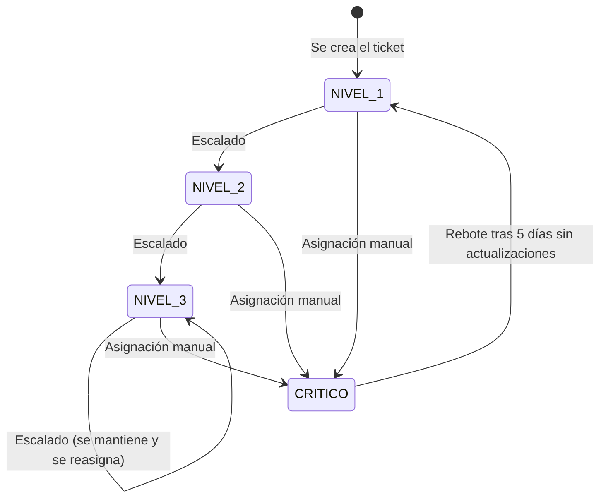

# TicketDesk: Reglas de Negocio

## Documento base: Trabajo Final Integrador UTN TUPaD

Este documento reúne en un solo lugar todas las reglas de negocio del sistema, que hasta ahora estaban repartidas entre el DER, el README y comentarios en el código. Cada regla incluye su justificación y dónde está implementada, para que se pueda auditar el sistema completo sin tener que rastrear cada decisión por separado.

---

# 1. Usuarios y Autenticación

## RN1: El email es único por empresa, no global

**Regla:** dos usuarios de empresas distintas pueden compartir el mismo email. La clave única real es la combinación (`empresa_id`, `email`).

**Por qué:** contempla el caso de una persona que trabaja como agente para más de una empresa cliente con el mismo correo. Cada cuenta queda completamente independiente, con su propia contraseña.

**Cómo se resuelve el login:** como el email ya no identifica a un usuario sin ambigüedad, el login exige también `empresaId`. Internamente se arma un identificador compuesto `empresaId:email` para que Spring Security identifique al usuario sin ambigüedad.

**Implementado en:** `Usuario.java` (restricción `unique(empresa_id, email)`), `CredencialUsuario.java`, `LoginRequest.java`, `AuthController.java`.

## RN2: Los usuarios nunca se eliminan físicamente

**Regla:** un usuario se desactiva (`activo = false`), nunca se borra de la base de datos.

**Por qué:** borrar un usuario haría perder el historial de todos los tickets, comentarios y cambios en los que participó, rompiendo la trazabilidad completa del sistema.

**Implementado en:** `Usuario.java` (campo `activo`).

## RN3: Un agente con tickets activos no puede desactivarse sin reasignarlos antes

**Regla:** si un agente tiene tickets activos asignados, el sistema rechaza la desactivación hasta que se reasignen a otro agente activo.

**Por qué:** evita que un ticket quede sin ningún responsable activo a cargo.

**Implementado en:** `UsuarioService.desactivar()` (`PATCH /usuarios/{id}/desactivar`, responde 409 con la cantidad de tickets abiertos si el agente todavía tiene alguno a su cargo).

## RN4: Un usuario puede tener más de un rol habilitado

**Regla:** además del rol principal (`usuarios.rol`), un usuario puede tener roles adicionales listados en `usuario_roles` (ej. ser Agente y Supervisor a la vez).

**Por qué:** en empresas grandes, una misma persona suele cumplir más de una función.

**Checking de rol previo:** antes de asignarle un rol nuevo a un usuario, el sistema verifica que no lo tenga ya asignado, para dar un error claro en vez de fallar silenciosamente por la restricción de unicidad de la base de datos.

**Implementado en:** `UsuarioRol.java`, `UsuarioRolRepository.existsByUsuarioIdAndRol()`.

---

# 2. Tickets: Ciclo de Vida y Clasificación

## RN5: El ticket pasa por "resuelto" antes de "cerrado"

**Regla:** el agente marca un ticket como `resuelto`, pero el cierre definitivo (`cerrado`) requiere confirmación del cliente, ya sea explícita (el cliente confirma) o tácita (no responde dentro del plazo).

**Por qué:** decisión explícita del tutor, para no perder la instancia de verificación con el cliente antes de dar un caso por terminado.

**Implementado en:** `EstadoTicket.java` (incluye `RESUELTO` como estado propio), `TicketService.cambiarEstado()`.

## RN6: Cierre automático por silencio del cliente (72hs)

**Regla:** si un ticket queda en estado `resuelto` y el cliente no responde ni reabre dentro de las 72 horas, el sistema lo cierra automáticamente.

**Por qué:** con volumen alto de tickets, no se puede depender de que el cliente confirme para recién ahí cerrar el caso. El silencio se interpreta como conformidad tácita.

**Implementado en:** `Ticket.fechaResuelto`, `TicketAutoCierreScheduler.cerrarPorSilencioDelCliente()` (corre cada hora).

## RN7: Rebote a Nivel 1 con marca "reincidente" por estancamiento en nivel máximo

**Regla:** si un ticket llega a nivel de atención `CRITICO` (el más alto) y queda sin avances por más de 5 días, vuelve a `NIVEL_1`, marcado como `reincidente`.

**Por qué:** evita que un caso quede trabado indefinidamente en el nivel más alto sin resolverse; al volver a Nivel 1 se retoma desde cero, pero con la alerta de que ya falló una vez en el nivel máximo.

**Implementado en:** `Ticket.reincidente`, `TicketAutoCierreScheduler.rebotarPorEstancamientoEnNivelMaximo()`.

## RN8: Prioridad del cliente y nivel de atención son campos independientes

**Regla:** `prioridad` (baja/media/alta) refleja la urgencia que percibe el cliente. `nivel_atencion` (Nivel 1 a Crítico) es la clasificación técnica interna, con su propio tiempo objetivo de resolución (SLA).

**Por qué:** si el sistema le "bajara" la urgencia percibida al cliente para asignarle un nivel técnico más bajo, el cliente podría sentir que se subestima su reclamo y cerrarlo sin que esté realmente resuelto.

**SLA por nivel:** Nivel 1 = 24hs, Nivel 2 = 48hs, Nivel 3 = 72hs, Crítico = 4hs.

**Implementado en:** `Prioridad.java`, `NivelAtencion.java` (con `horasObjetivoResolucion` por nivel), `TicketService.cambiarNivel()` y `TicketAutoCierreScheduler.rebotarPorEstancamientoEnNivelMaximo()`.

### Transiciones del nivel de atención (ampliación de RN8)

Esta sección explica cómo se llega a cada nivel de atención, quién puede cambiarlo y qué ocurre después. Aclara en especial cómo se alcanza el nivel Crítico y quién puede asignarlo.

**Cómo se llega a cada nivel**

| Nivel | Cómo se alcanza | Quién lo origina |
|---|---|---|
| `NIVEL_1` | Es el nivel inicial de todo ticket. También es el nivel al que vuelve un ticket estancado en Crítico, marcado como reincidente | El sistema |
| `NIVEL_2` | Al escalar un ticket que está en Nivel 1, o por asignación manual | El sistema al escalar, o un agente o supervisor |
| `NIVEL_3` | Al escalar un ticket que está en Nivel 2, o por asignación manual | El sistema al escalar, o un agente o supervisor |
| `CRITICO` | **Solo por asignación manual.** Ninguna regla automática lleva un ticket a este nivel. Escalar un ticket que ya está en Nivel 3 no lo modifica | Un agente o supervisor |

Además de las transiciones del diagrama, un agente o supervisor puede pasar un ticket de cualquier nivel a cualquier otro, incluso a uno inferior.

**Quién puede cambiar el nivel de forma manual**

| Actor | ¿Puede cambiar el nivel? | Respuesta si no puede |
|---|---|---|
| Cliente | No | 403 |
| Agente | Sí | - |
| Supervisor | Sí | - |
| Administrador sin rol de agente ni de supervisor | No | 403 |
| Sistema | Solo el rebote desde Crítico | - |

Condiciones del cambio manual (`PATCH /tickets/{id}/nivel`):

- El ticket debe pertenecer a la empresa de quien lo cambia (si no, 404) y no puede estar cerrado (se responde que el ticket está cerrado y no admite cambios).
- El motivo es opcional, pero se recomienda indicarlo.
- Cada cambio queda en el historial con el campo `nivel_atencion`, el valor anterior y el nuevo, quién lo hizo y el motivo.
- El cliente no ve el nivel de atención en sus pantallas.

**Qué pasa con un ticket en Crítico**

Si un ticket está en `CRITICO`, no está resuelto ni cerrado y pasan más de 5 días sin ninguna actualización, el planificador (que se ejecuta cada hora) lo devuelve a `NIVEL_1`, lo marca como reincidente y registra el cambio sin autor (en el historial figura "Sistema"). "Sin avances" significa que la fecha de última modificación del ticket supera ese plazo. Esa fecha cambia cuando se modifica el estado, el agente o el nivel; agregar un comentario no la modifica. Si se elige el mismo nivel que el actual, no hay cambio y no se registra nada.

**Efecto sobre el tiempo objetivo (SLA)**

El vencimiento se calcula como la fecha de creación del ticket más las horas del nivel vigente. Por eso, al pasar un ticket a Crítico (4 horas), si fue creado hace más de 4 horas el tiempo objetivo figura vencido desde ese momento. Al volver a Nivel 1 se recalcula con 24 horas. Esta forma de cálculo es una decisión de la primera versión. Como mejora futura queda contar el tiempo objetivo desde el momento del cambio de nivel.

**Decisión de diseño y mejora futura**

En esta versión no existe una restricción propia para el nivel Crítico: lo puede asignar cualquier agente o supervisor, con motivo opcional. Se priorizó la agilidad de respuesta ante un caso grave y la trazabilidad por el historial. Como mejora futura se plantea que solo los supervisores puedan asignar el nivel Crítico y que el motivo sea obligatorio.

**Preguntas frecuentes**

| Pregunta | Respuesta |
|---|---|
| ¿Cómo llega un ticket al nivel Crítico? | Solo porque un agente o un supervisor lo asigna a mano |
| ¿Puede hacerlo un administrador? | No, salvo que además tenga el rol de agente o de supervisor |
| ¿Escalar un ticket lo lleva a Crítico? | No. Escalar sube un nivel hasta Nivel 3 y se detiene ahí |
| ¿Qué evita que un caso quede trabado en Crítico? | El rebote automático a Nivel 1, marcado como reincidente, tras 5 días sin actualizaciones |
| ¿Queda registro de quién puso un ticket en Crítico? | Sí, en el historial, con la persona, la fecha y el motivo si lo indicó |

## RN9: El escalado reasigna a un usuario con rol Supervisor

**Regla:** cuando un ticket pasa a estado `escalado`, se reasigna a un usuario con rol `ROLE_SUPERVISOR`, con motivo obligatorio.

**Por qué:** separa claramente el nivel de resolución estándar del nivel que requiere intervención de mayor jerarquía o experiencia.

**Implementado en:** `TicketService.cambiarEstado()` y `TicketService.aplicarEscalado()`: al escalar se exige el motivo, el ticket sube un nivel de atención (hasta `NIVEL_3`) y se reasigna al supervisor con menos tickets abiertos. `Rol.java` define `ROLE_SUPERVISOR`.

---

# 3. Categorías

## RN10: Modelo híbrido de categorías (genéricas + propias por empresa)

**Regla:** existe un catálogo de categorías genéricas compartido por todas las empresas, y cada empresa puede sumar categorías propias específicas de su rubro.

**Por qué:** da flexibilidad real por rubro sin perder la comparabilidad general del sistema (el catálogo genérico sigue existiendo como base común para reportes generales).

**Restricción:** la combinación (`empresa_id`, `nombre`) es única; una empresa no puede repetir el nombre de una categoría propia.

**Implementado en:** `Categoria.java` (campo `empresa` opcional), `CategoriaRepository.findVisiblesParaEmpresa()`.

---

# 4. Trazabilidad y Auditoría

## RN11: Toda modificación relevante queda registrada, no solo cambios de estado

**Regla:** la tabla `historial_cambios` registra cualquier cambio relevante (estado, agente asignado, categoría, prioridad, nivel de atención, etc.) de cualquier entidad del sistema, no solo tickets.

**Por qué:** trazabilidad completa significa saber también quién reasignó un ticket o le cambió la categoría, no solo cuándo cambió de estado. Generalizarla a cualquier entidad (no solo Ticket) permite auditar en el futuro cambios de Usuario, Empresa, etc., sin rediseñar la tabla.

**Trade-off aceptado:** al ser genérica, `entidad_id` no tiene una clave foránea tipada (puede apuntar a distintas tablas según el valor de `entidad`), a diferencia de una relación JPA tradicional.

**Implementado en:** `HistorialCambios.java`, `HistorialCambiosRepository.java`.

## RN12: Los cambios automáticos del sistema quedan diferenciados de los hechos por una persona

**Regla:** en `historial_cambios`, el campo `usuario_id` queda en `null` cuando el cambio lo hizo el sistema (ej. cierre automático, rebote por estancamiento), no una persona.

**Por qué:** permite distinguir en el historial qué pasó por decisión humana y qué pasó por una regla automática.

**Implementado en:** `TicketAutoCierreScheduler.registrarHistorialAutomatico()`.

---

# 5. Comunicación (Comentarios y Adjuntos)

## RN13: Solo el cliente puede subir adjuntos

**Regla:** los agentes responden únicamente con texto; la subida de fotos está restringida al rol `ROLE_USER`.

**Por qué:** una foto puede contener información ambigua sujeta a interpretación subjetiva de quien la ve después. El objetivo del sistema es mantener control total y trazabilidad verificable de cada paso de la resolución, por eso toda respuesta técnica del agente queda registrada como texto auditable.

**Implementado en:** `ComunicacionService.subirAdjunto()` (`POST /tickets/{id}/adjuntos`, responde 403 si el usuario no tiene rol `ROLE_USER`). Además solo acepta imágenes y respeta el módulo `adjuntos` de la empresa.

## RN14: Trazabilidad de tickets creados por voz

**Regla:** cuando un ticket se crea por voz, se guarda tanto el audio original (`audio_url`) como la transcripción exacta (`transcripcion_original`), antes de cualquier interpretación de palabras clave.

**Por qué:** permite auditar si el sistema de reconocimiento de voz categorizó correctamente, sin depender únicamente de su interpretación automática.

**Implementado en:** `Ticket.java` (campos `canalOrigen`, `audioUrl`, `transcripcionOriginal`).

---

# 6. Multi-Empresa (Multi-Tenant)

## RN15: Aislamiento completo de datos entre empresas

**Regla:** casi todas las entidades principales llevan `empresa_id`, garantizando que los datos de una empresa nunca se mezclen con los de otra.

**Por qué:** es la base del modelo multi-tenant: una sola infraestructura sirve a múltiples empresas clientes sin comprometer la privacidad de sus datos.

**Implementado en:** `Empresa.java` y su relación con `Usuario`, `Ticket`, `Categoria` (cuando es propia), `ConfiguracionEmpresa`.

## RN16: Configuración de módulos flexible por empresa (JSONB, no NoSQL separada)

**Regla:** cada empresa puede habilitar o deshabilitar módulos del menú base. Esta configuración se guarda como columna JSONB dentro de PostgreSQL, no en una base de datos NoSQL separada.

**Por qué:** permite modificar qué módulos tiene habilitados cada empresa sin necesidad de `ALTER TABLE` ni migraciones, manteniendo la ventaja de indexación y consulta de PostgreSQL, y evitando la complejidad de mantener dos motores de base de datos distintos para un proyecto de este tamaño.

**Implementado en:** `ConfiguracionEmpresa.java` (campo `modulosHabilitados`, tipo JSONB).

## RN17: Ventana de mantenimiento configurable por empresa

**Regla:** cada empresa puede configurar un horario propio (hora de inicio y fin) durante el cual el sistema no procesa altas de tickets ni cambios de estado, y muestra un aviso de indisponibilidad temporal.

**Por qué:** permite realizar tareas de mantenimiento, actualizaciones o backups sin afectar el uso normal del sistema en horario productivo. Al ser configurable por empresa (no fijo para todo el sistema), cada cliente puede elegir el horario que menos impacte su propia operación.

**Implementado en:** `ConfiguracionEmpresa.java` (campos `ventanaMantenimientoInicio`, `ventanaMantenimientoFin`, configurables con `PATCH /empresas/{id}/configuracion`) y `MantenimientoFilter.java`, que durante la ventana responde 503 a las escrituras sobre tickets y deja pasar las consultas. Soporta ventanas que cruzan la medianoche.

## RN18: Casos fuera del alcance del software

**Regla:** un ticket puede marcarse como reclamo formal (sujeto a normativa de protección al consumidor) y puede registrar los datos de contacto de un responsable externo al sistema, para casos que requieren intervención humana directa.

**Por qué:** no todo caso se resuelve dentro del software; el sistema debe poder señalar cuándo un caso escapa a su propia lógica y necesita intervención humana o legal.

**Implementado en:** `Ticket.java` (campos `esReclamoFormal`, `responsableExterno`).

**Estado de implementación:** parcial. El modelo de datos y la respuesta de la API incluyen ambos campos (por defecto, no es reclamo formal y sin responsable externo), pero esta versión no ofrece todavía una operación ni una pantalla para completarlos. Queda como mejora futura.

---

# Índice Rápido de Reglas

| # | Regla | Área |
|---|---|---|
| RN1 | Email único por empresa | Usuarios |
| RN2 | Usuarios nunca se eliminan | Usuarios |
| RN3 | Reasignación obligatoria antes de desactivar agente | Usuarios |
| RN4 | Multi-rol de usuario | Usuarios |
| RN5 | Resuelto antes de cerrado | Tickets |
| RN6 | Cierre automático a las 72hs | Tickets |
| RN7 | Rebote a Nivel 1 (reincidente) | Tickets |
| RN8 | Prioridad y nivel de atención independientes | Tickets |
| RN9 | Escalado a Supervisor | Tickets |
| RN10 | Categorías híbridas | Categorías |
| RN11 | Historial genérico por cualquier entidad | Auditoría |
| RN12 | Cambios automáticos diferenciados | Auditoría |
| RN13 | Solo el cliente sube adjuntos | Comunicación |
| RN14 | Trazabilidad de tickets por voz | Comunicación |
| RN15 | Aislamiento de datos multi-empresa | Multi-tenant |
| RN16 | Configuración flexible por empresa (JSONB) | Multi-tenant |
| RN17 | Ventana de mantenimiento configurable | Multi-tenant |
| RN18 | Reclamo formal y responsable externo | Multi-tenant |
